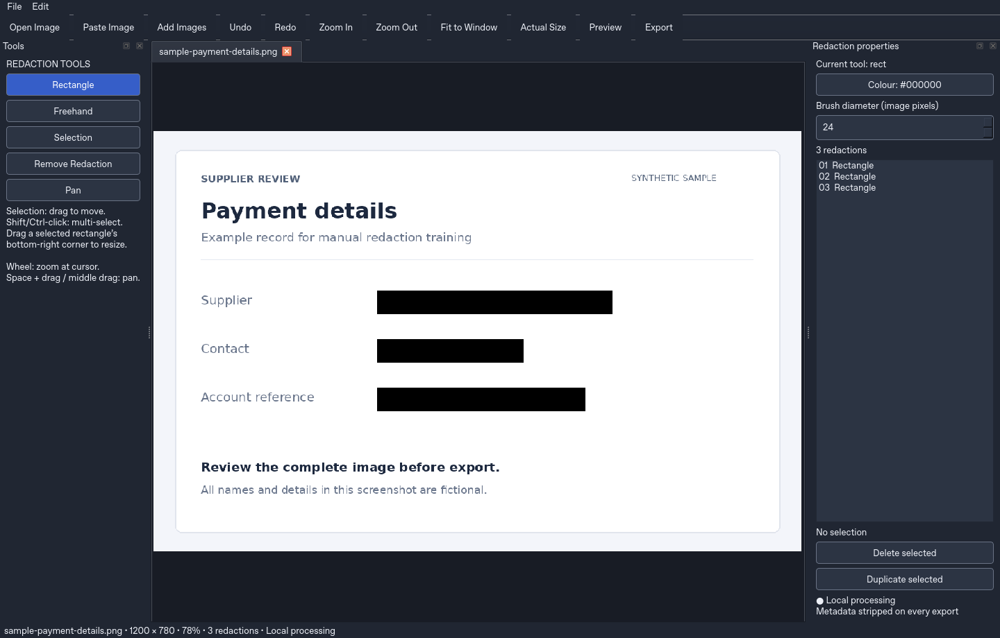

# Redact Studio

**Redact sensitive information in images, entirely on your own device.**

A native desktop editor for images and PDFs that permanently replaces selected image pixels and automatically removes inherited metadata from exported copies. Built with Python, PySide6, Pillow and PDFium for offline use.

[](https://github.com/morganridges1-blip/Redact-Studio/actions/workflows/windows.yml)
[](#development)
[](LICENSE)

[Download](#download-for-windows) · [Features](#features) · [Getting started](#getting-started) · [Security](#security-and-privacy) · [Development](#development)



*The screenshot uses fictional sample data. [Start screen](docs/images/start-screen.png) · [Light theme](docs/images/light-theme.png)*

## Download for Windows

### [Download RedactStudio-Windows.zip](https://github.com/morganridges1-blip/Redact-Studio/actions/runs/40348143437/artifacts/12661539918)

Portable application with image and PDF support · 56.8 MB · Python installation not required

1. Download the application ZIP using the link above.
2. Extract **all files** into a folder on your computer.
3. Double-click **`RedactStudio.exe`** to launch the application.

Keep the **`_internal`** folder beside the executable. It contains the libraries the application needs to run.

> **Updating an older copy?** Replace the entire application folder, including `_internal`. The current package uses **Pillow 13.0.0**, which patches the reported Pillow vulnerabilities. See the [dependency security review](DEPENDENCY_SECURITY.md).

GitHub’s **Code → Download ZIP** downloads the Python source. For the executable, use the application download above. You can also find application artifacts under [Windows builds](https://github.com/morganridges1-blip/Redact-Studio/actions/workflows/windows.yml).

Windows is the deployment target. The executable is unsigned; Windows CI tests and the packaged self-test pass, while interactive Windows 11 acceptance testing remains outstanding. See the [validation record](VALIDATION.md).

## Features

- **PDF processing:** edit pages with the same redaction tools, navigate within a document and export a new image-only PDF after reviewing every page.

- **Manual redaction:** draw opaque rectangles or paint continuous freehand strokes with an adjustable brush.
- **Editable selections:** select, move, resize, duplicate and delete regions, with independent undo/redo history for each image.
- **Image navigation:** cursor-centred zoom from 10–800%, fit-to-window, actual size and drag panning.
- **Multiple images:** work in separate tabs, then export individually or review each image in a batch.
- **Export review:** inspect the decoded output image before confirming a save, including an explicit acknowledgement for images with no redactions.
- **Clipboard support:** paste an image or copy reviewed, sanitised output pixels.
- **Appearance and defaults:** dark/light themes, solid redaction colours and configurable export preferences.

### Supported formats

| Operation | Formats |
| --- | --- |
| Import | PDF, PNG, JPEG/JPG, BMP, single-frame TIFF and WebP |
| Export | PDF for PDF documents; PNG, JPEG and lossless WebP for images |
| Default export | PNG, named `OriginalFilename_REDACTED.png` |

Animated and multi-frame images are rejected. Images are limited to **24 megapixels each**, with a **48-megapixel** budget across open documents. Source orientation and image resolution are preserved; transparency is flattened against white on export.

## Working with PDFs

Open a PDF, use the page controls to navigate, and redact each page as you would an image. Export creates a **new PDF containing all sanitised pages**. Review all pages in one scrollable overview and confirm the whole PDF once. Double-click a page for full-resolution inspection; pages without redactions are clearly flagged.

PDF pages use **300 DPI by default**, with 200, 400 and 600 DPI available in **File → Settings** for newly opened PDFs. Editing and export use the same resolution. Higher DPI improves vector text and diagrams; it cannot recover detail missing from low-resolution source images. The exported PDF contains image-only pages: source text layers, metadata, attachments and interactive content are removed. Searchable text, links, form fields, accessibility tags and digital signatures are not preserved. Password-protected/encrypted PDFs and XFA forms are not supported.

See [PDF processing](PDF_SUPPORT.md) for page/file limits, rendering behaviour and security tests.

## Getting started

1. **Open an image.** Use the toolbar, drag a file into the window or paste from the clipboard.
2. **Mark sensitive content.** Choose Rectangle or Freehand, then cover the information you want removed. Use Selection to adjust regions.
3. **Review the output.** Select Preview or Export and inspect the entire image at its output resolution.
4. **Save a sanitised copy.** Choose a format and destination, confirm your review and export.

Exports default to the imported file’s folder. An explicit export folder in Settings takes priority; leave it blank to use the source folder. Clipboard images use the home-folder fallback when no export folder is set. Existing filenames receive a unique suffix. Original files are opened read-only and are never overwritten. Every export strips inherited metadata, including images exported without redactions.

PNG is recommended for predictable pixel coverage. JPEG expands redactions to complete **8×8 compression blocks** and disables chroma subsampling; its review preview shows the expanded coverage. WebP exports use lossless encoding.

<details>
<summary><strong>Keyboard shortcuts and navigation</strong></summary>

| Shortcut | Action |
| --- | --- |
| `Ctrl+O` / `Ctrl+V` | Open / paste an image |
| `Ctrl+S` / `Ctrl+Shift+S` | Export / export as |
| `Ctrl+Z` | Undo |
| `Ctrl+Y` / `Ctrl+Shift+Z` | Redo |
| `R` / `B` | Rectangle / freehand tool |
| `V` / `H` | Selection / pan tool |
| `Delete` / `Ctrl+D` | Delete / duplicate selected regions |
| `Ctrl+0` / `Ctrl+1` | Fit to window / actual size |
| `Ctrl+Shift+C` | Review and copy sanitised image |
| `Esc` | Cancel the current operation |
| Mouse wheel | Zoom at the cursor |
| Middle-drag / `Space` + drag | Pan |

In Selection mode, Ctrl/Shift-click to select multiple regions. Drag a selected rectangle’s bottom-right corner to resize it. The properties list can also select individual redactions.

</details>

## Security and privacy

Image processing happens locally. The application has no upload, telemetry, AI, machine learning or OCR functionality. Installation and building require dependency downloads; using the installed application does not require an Internet connection.

Export creates a fresh pixel buffer, overwrites the selected regions with opaque colours and re-encodes the result. Source layers, original image bytes and inherited metadata dictionaries are not included in the exported file. Metadata removal is mandatory: EXIF, GPS, XMP, IPTC, embedded thumbnails, source ICC profiles and other inherited fields are discarded. Format-required structural information and normal new-file filesystem timestamps remain.

The application does not create unredacted temporary image files or save document paths and editing histories as preferences. Windows clipboard history, synchronisation, operating-system caches and external backup software are outside the application’s control. Copying an image displays a clipboard privacy warning.

**Manual review is required.** Redact Studio does not identify confidential information automatically. Discarding source colour profiles can change colour appearance, and edits are held in memory without autosave.

Read the [security model and Windows acceptance checklist](SECURITY.md), [dependency advisory review](DEPENDENCY_SECURITY.md) and [test results](VALIDATION.md) before organisational deployment. These checks do not constitute security certification.

## Development

Requires **Python 3.12+** and a desktop session. Runtime dependencies are **PySide6**, **Pillow** and **pypdfium2**; testing and packaging use **pytest** and **PyInstaller**.

### Run from source on Windows

```powershell
git clone https://github.com/morganridges1-blip/Redact-Studio.git
cd Redact-Studio
py -3.12 -m venv .venv
.\.venv\Scripts\python -m pip install --upgrade pip==26.2.2
.\.venv\Scripts\python -m pip install -r requirements-dev.txt
.\.venv\Scripts\python main.py
```

On Linux/macOS, create the environment with `python3 -m venv .venv` and use `.venv/bin/python` in place of `.venv\Scripts\python`.

### Run tests

```powershell
$env:QT_QPA_PLATFORM = 'offscreen'
.\.venv\Scripts\python -m pytest -q
.\.venv\Scripts\python main.py --self-test

# Repeat GUI checks at 200% display scaling.
$env:QT_SCALE_FACTOR = '2'
.\.venv\Scripts\python -m pytest tests/test_gui.py -q
```

For headless Linux, use `QT_QPA_PLATFORM=offscreen .venv/bin/python -m pytest -q`.

The patched build passes **79 tests** and the packaged Windows application self-test. Tests use synthetic content to check pixel replacement, metadata removal, source integrity, export failures and editor interactions. The GUI suite also passes at 200% scaling on Linux; physical Windows monitor testing remains part of the acceptance checklist.

### Build the Windows executable

Run on Windows with Python 3.12 installed:

```powershell
powershell -ExecutionPolicy Bypass -File packaging/build-windows.ps1
```

The script installs the pinned dependencies, runs tests, builds the application and checks the packaged executable. Output is written to **`dist/RedactStudio/`**. Distribute that entire folder, including its libraries and licence notices.

The [GitHub Actions workflow](.github/workflows/windows.yml) performs the Windows build and uploads the application artifact. PyInstaller builds Windows executables on Windows; it does not cross-compile them from Linux.

## Documentation

| Document | Contents |
| --- | --- |
| [PDF processing](PDF_SUPPORT.md) | Page editing, image-only export, limits and validation |
| [Security](SECURITY.md) | Data handling, export guarantees, limitations and deployment checklist |
| [Dependency security](DEPENDENCY_SECURITY.md) | Patched Pillow advisories and replacement package details |
| [Validation](VALIDATION.md) | Executed checks, build evidence and outstanding acceptance tests |
| [Dependency audit](packaging/dependency-audit-2026-10-26.json) | Dated advisory metadata for the Linux development environment |

## Licence

Distributed under the [GNU General Public License v3.0](LICENSE). Bundled dependencies retain their respective licences and notices.
